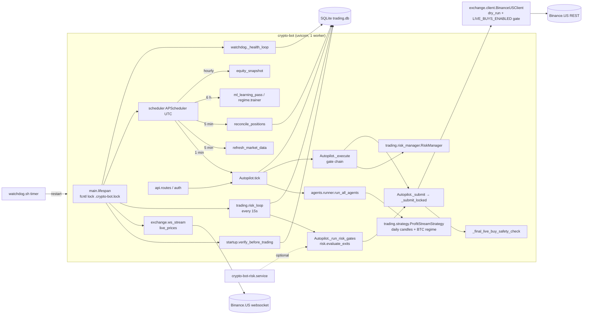

# ProfitStream architecture and trade lifecycle

Derived from the code at `4d3711c`. Line references are approximate anchors;
the function names are authoritative.

## 1. Processes on the droplet

| Unit | Process | Role |
|---|---|---|
| `crypto-bot.service` | `uvicorn app.main:app --workers 1` (port 8000) | API/dashboard, scheduler, autopilot ticks, in-process risk loop, health monitor, price websocket |
| `crypto-bot-risk.service` (optional) | `python -m app.trading.risk_loop` | Same risk loop out-of-process; only meant for `risk_loop_in_process_enabled=false`. Serialized with the in-process loop by the `risk_loop` kv lock |
| `crypto-bot-watchdog.timer` → `.service` | `scripts/watchdog.sh` every 5 min (root) | `systemctl restart crypto-bot` if `/healthz` fails or the last successful tick is > 20 min old |

All three share one SQLite DB: `data/cache/trading.db` (WAL) when the ledger is
live, `data/cache/simulation/trading.db` otherwise.

## 2. Component map

`app/exchange/` is the only package that imports `binance`; everything else
talks to `BinanceUSClient`, `filters`, `live_prices`.

## 3. Startup (`app/main.py::lifespan`)

1. `_process_lock` — exclusive non-blocking `fcntl` lock on `data/cache/.crypto-bot.lock`; a second instance raises and exits.
2. Logging, `process_started_at` kv, LLM availability warning, trading-mode banner, expired-session purge.
3. `filters.load()` — Binance.US `exchangeInfo` (LOT_SIZE, MIN_NOTIONAL).
4. `startup.verify_before_trading()` (fatal on exception):
   - `initialize_halt_states()` — inserts **only missing** `drawdown_halt` / `emergency_halt` / `tick_protection` rows as inactive;
   - risk-state migration, interrupted-tick recovery;
   - pending order intents or `order_outcome_unknown` → `emergency_halt` (`order_outcome_unknown`);
   - running state without baseline → `baseline_unavailable`;
   - legacy drawdown state → persistent `drawdown_halt`;
   - `reconcile_positions`; live: open orders vs expected `pstop-` stops; any mismatch → `emergency_halt` (`new_entries_blocked`).
5. Paper seed (paper only), price websocket, **risk loop**, scheduler, health monitor, startup report.

The autopilot's `running` flag is restored from kv `autopilot_state`, so ticks
resume after a restart without an operator action.

## 4. Entry lifecycle (one scheduler tick, every minute)

`Autopilot.tick` → `_tick_once`:

1. In-process lock + cross-process kv lock `autopilot_tick` (prevents two ticks from two processes).
2. Ensure exchange filters loaded (else `exchange_filters_unavailable` entry halt).
3. `_check_circuit_breaker` — persisted `drawdown_halt`, drawdown vs `starting_balance_usdt` (`drawdown_circuit_breaker_pct`), daily loss limit. Failure to check → `circuit_breaker_check_failed` entry halt.
4. `run_all_agents(use_llm=False)`:
   - universe from `exchange.symbol_source.get_symbols` (liquidity-ranked dynamic list, static fallback);
   - BTC daily candles (`DAILY_FETCH_BARS`); on failure the whole pass returns no signals;
   - per symbol `ProfitStreamStrategy.analyze_symbol` on **closed daily** bars → `StrategyDecision(action, score 0–110, reasons, indicators)` and a `tick_audit` row;
   - BUY survives only if `score >= profitstream_score_threshold` (default 80); SELL always survives;
   - writes kv `profitstream_scan` (actions, highest score, BTC regime, breadth);
   - with `profitstream_use_legacy_agents=false` (default) ProfitStream is the **sole** signal source.
5. `_execute(signals, allow_buys=not breaker_tripped)`:
   - ML gate model load (stale > `ml_gate_max_model_age_hours` or missing → `ml_gate_unavailable`, fail-closed);
   - `_entry_block_reason()` (baseline, breaker-check, filters, ML, emergency halt, tick protection) → BUYs disabled for the tick;
   - BUY gate chain, in order: confidence floor → ML probability → listed on Binance.US → drawdown/entry block → blocked symbol → already held (pyramid rules) → cooldown → stop-loss cooldown → `RiskManager.evaluate_entry` (max positions, max long exposure, loss-streak pause, sizing) → protective-stop feasibility → correlation basket → **BTC market regime** → **breadth** → per-symbol trend → cash available → funding → on-chain → order book → `_place_buy`.
6. `_place_buy` → `_buy_order_plan` (LOT_SIZE rounding, MIN_NOTIONAL) → `_submit` (cross-process kv lock `order:<mode>:<symbol>:<side>`, refuses while an unresolved intent exists for that symbol/side) → `_submit_locked`:
   - live BUY: `_final_live_buy_safety_check` (kill switch, running live, baseline, filters, the three halt rows readable and inactive, `entry_status`, listing/min-notional, live USDT, re-run of `RiskManager`, order ≤ risk budget);
   - `record_order_intent` with a fresh `newClientOrderId`, then `BinanceUSClient.place_order` (MARKET). The client refuses BUYs when `LIVE_BUYS_ENABLED=false` and simulates when `dry_run`;
   - exception → `_resolve_order_after_exception` looks the order up by client ID; unknown outcome → `order_outcome_unknown` emergency halt;
   - only an exchange-confirmed fill is booked: `record_live_fill` at executed qty net of base-asset commission and average fill price; then `_place_protective_stop` (only if exchange-native stops are enabled for the symbol).
7. `entry_status` kv is written in `finally` with the halt reasons for dashboards and the final gate.

### Sizing (`RiskManager.evaluate_entry`)

`notional = min(equity × risk_per_trade_pct ÷ stop_loss_pct, equity × kelly_fraction_cap, equity × position_pct)`
where `position_pct` is `aggressive_position_pct` (default 0.06) when aggressive
mode is active, else `rollback_position_pct` (default 0.03). **`max_position_pct`
is not used by this sizing path.** Open-position cap is
`min(aggressive_|rollback_max_open_positions, max_open_positions)`; new entries
stop at `max_long_exposure_pct` of equity in non-USDT assets.

With defaults (1% risk, 4% stop, 25% Kelly cap) the binding cap is the
position percentage: 3% (or 6% aggressive) of equity per entry, ≤ 12 positions,
≤ 60% total long exposure.

## 5. Exit lifecycle (independent risk loop, every `risk_manager_loop_seconds`, default 15 s)

`risk_loop._run_once` takes the kv lock `risk_loop`, then `Autopilot._run_risk_gates`:

1. Live balances via `portfolio_snapshot`; a failed balance fetch submits **no** SELL.
2. Price (websocket if fresh, else REST) and ATR% per position.
3. `risk.evaluate_exits`, first match wins:
   1. hard stop: ATR-scaled (`atr_stop_multiple × ATR%`, clamped to `[max(atr_stop_min_pct, stop_loss_pct), atr_stop_max_pct]`), else `stop_loss_pct`;
   2. TP1 (`take_profit_1_pct`, sells `take_profit_1_fraction`), then TP2;
   3. trailing stop (`trailing_stop_pct` below high-water mark, armed above `trailing_activation_pct`);
   4. stale "dead money" exit after `stale_exit_hours`;
   5. max hold `max_hold_hours`.
4. If an exchange stop exists for the symbol: detect whether it already filled (record that exit) or cancel it before selling.
5. SELL the real free balance (TP slices sell only their slice); dust/phantom rows are closed without fabricating PnL.
6. `reconcile_protective_stops()` keeps exchange-native stops in line (flag + canary allowlist).
7. Heartbeat kv `risk_loop_last_run` on success.

Strategy SELL signals (mean-reversion exit, momentum deterioration) also flow
through `_execute` → `_place_sell`.

**Stops are app-side unless `exchange_native_stops_enabled=true`** (default
false) and the symbol is in `exchange_native_stops_canary_symbols`. App-side
exits stop working whenever both the main process and the optional risk service
are down.

## 6. Protections and where they live

| Protection | Implementation | Blocks |
|---|---|---|
| Single instance | `main._process_lock` (fcntl) | second app process |
| Tick / risk-loop exclusivity | kv locks `autopilot_tick`, `risk_loop` | concurrent ticks / exits across processes |
| Per-symbol order lock | `_submit` kv lock + unresolved intents | duplicate orders |
| Idempotency | `newClientOrderId` + `order_intents` + lookup by client ID | double fills on retry |
| BUY kill switch | `LIVE_BUYS_ENABLED` in `BinanceUSClient.place_order` and final gate | all live BUYs |
| Drawdown halt | `_check_circuit_breaker` → kv `drawdown_halt` (operator recovery only) | new BUYs |
| Emergency halt | `watchdog.trigger_emergency_halt` → kv `emergency_halt` (auto-clear after healthy cycles, never for `order_outcome_unknown`) | new BUYs |
| Tick protection | `watchdog.engage_tick_protection` → kv `tick_protection` | new BUYs |
| Entry safety halts | kv `baseline_unavailable`, `circuit_breaker_check_failed`, `exchange_filters_unavailable`, `ml_gate_unavailable` | new BUYs |
| Final live-BUY gate | `_final_live_buy_safety_check` | the individual order |
| Exits | risk loop (`evaluate_exits`) + optional exchange-native stops | — |

No protection above blocks SELLs.

## 7. Watchdog and health

- In-process `watchdog._health_loop` (started by `start_health_monitor`): checks scheduler, trade loop, risk loop, websocket staleness, Binance REST/account, duplicate orders/positions, failed and open orders, portfolio discrepancy (with `reconcile_positions`), memory/CPU; records component heartbeats and `health_status`; engages/clears emergency halt and tick protection.
- External `scripts/watchdog.sh` (systemd timer) restarts the service on liveness failure or a stalled tick.
- `GET /healthz` is pure liveness. `GET /health` is a readiness summary and writes a `healthz_probe` kv row.

## 8. Reconciliation

- `reconcile_positions` — at startup, every 5 min (scheduler), and from the health loop.
- `reconcile_protective_stops` — inside each risk-loop iteration.
- `fill_reconcile.reconcile_fills` — **manual only** (`python -m scripts.reconcile_fills`); not scheduled (see `docs/PROFITSTREAM_DEPLOYMENT_PACKAGE_2026-11-13.md`).

## 9. Notes for reviewers

- Breadth (`runner.run_all_agents`) fails closed unless **every** non-BTC universe symbol produced usable daily data, there are ≥ `breadth_min_symbols`, and the fraction above the breadth EMA ≥ `breadth_min_fraction`.
- `_market_gate` blocks all new longs at BTC regime score ≤ −1 and on missing data; score 0 (sideways) is allowed but `_execute` raises the required entry score by `market_regime_sideways_score_bonus`.
- The config comment on `ml_gate_max_model_age_hours` says a stale model makes the gate advisory; the code fails closed (blocks BUYs). The retrain job refreshes at 75% of the max age.
- `max_position_pct` is reported by `scripts/inspect_trading_mode.py` but does not size entries; `rollback_position_pct` / `aggressive_position_pct` do.
