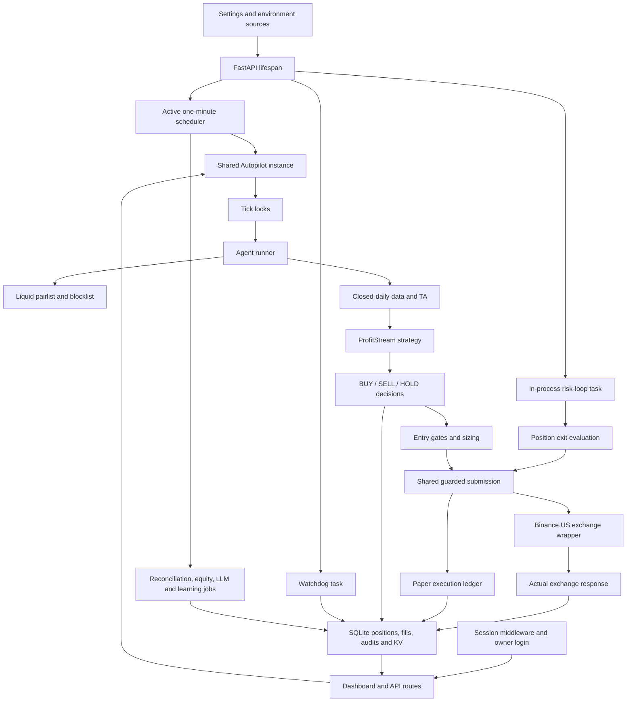

# PROFITSTREAM — AUTOPILOT AND EXECUTION SYSTEM AUDIT

Date: 2026-11-11 UTC. Status: audit and design complete for approval; repairs
not implemented in this audit. **Do not deploy the current working tree.**

Subsequent development repair approval and implementation are documented in
[execution repair notes](PROFITSTREAM_EXECUTION_REPAIR_2026-11-11.md). The
production observations and original findings below remain historical evidence;
they do not describe the repaired working tree or grant deployment approval.

The requested implementation sequence includes approval before development
changes. This report is the Phase 4 approval deliverable, not a claim that the
proposed reconstruction has already been implemented or certified.

## 1. Executive Finding

**Production ticks are executing. No current scheduler stall was found.**
At 11:05:24 UTC, production had completed the 11:05 scheduled scan:

| Evidence | Observed value |
|---|---|
| Loaded and checkout revision | `7819d3bc39a837db3c2b161bba64896fade93009` |
| Checkout | Clean |
| Service | Active; PID 174351; user `cryptobot`; one uvicorn process |
| Process start | 10:30:16 UTC; systemd `NRestarts=0` |
| Autopilot | Running; mode `live`; persisted `last_error` empty |
| Tick start | 11:05:00.004394 UTC |
| Scan persisted | 11:05:11.541326 UTC |
| Execution diagnostics persisted | 11:05:11.548216 UTC; `no_signals=1` |
| Pairs / actions | 44 evaluated; 44 HOLD; zero qualified BUYs |
| Maximum score | 30 against the unchanged 80-point threshold |
| BTC regime | BEAR; strong-bull entry policy not satisfied |
| Breadth | 0/43 non-BTC pairs above EMA20; entry policy not satisfied |
| Entry safety halt | Inactive; emergency and drawdown halt inactive |
| Tick lock | No active row after the observed completion |
| Risk-loop heartbeat | Fresh, approximately 14 seconds old at collection |
| Positions in database | Zero |
| Exchange open orders | Zero, independently checked with a read-only API call |

The journal contains one completed `signals=0 no_signals=1` tick per minute
from 10:46 through 11:05. Tick-start-to-diagnostics elapsed approximately
11.5 seconds for the sampled run; this is an observation, not an existing
authoritative duration field. All-HOLD is successful market evaluation,
not evidence of failed order execution. Even a qualifying strategy BUY
would still need the independent regime, breadth, risk, sizing, and final
submission checks.

The current execution stops intentionally at **no qualifying strategy
signal**, not at a stuck scheduler or exchange rejection. This snapshot
does not prove every historical tick or every failure path was healthy.

## 2. Component and Communication Map

| Surface | Owning implementation and dependencies |
|---|---|
| Bootstrap and shutdown | [main.py](../app/main.py): startup verification, filters, websocket, risk task, scheduler, watchdog; static public `/healthz` |
| Web UI and controls | [routes.py](../app/api/routes.py): server-rendered HTML, settings persistence, start/liquidate controls, status, diagnostics, manual API |
| Authentication | [auth](../app/auth/): owner login, session cookies, verification/reset email, middleware and IP allowlist |
| Scheduling | [scheduler.py](../app/scheduler/scheduler.py) is exported by the package; callbacks are in [jobs.py](../app/scheduler/jobs.py) |
| Strategy orchestration | [runner.py](../app/agents/runner.py): pairlist, daily strategy, per-pair audit, scan summary; optional legacy ensemble |
| Legacy agents | [agents](../app/agents/): trend, momentum, mean reversion, breakout, volatility, regime and LLM; signals combine through [signals](../app/signals/types.py) |
| Data and TA | [ohlcv.py](../app/data/ohlcv.py), [daily.py](../app/data/daily.py), [indicators.py](../app/ta/indicators.py): atomic cache replacement, completed UTC candles, freshness/history/gap checks, TA fallback |
| Exchange and universe | [exchange](../app/exchange/): async connector wrapper, filters, books, liquidity universe, websocket, telemetry, optional derivatives context |
| Entry policy | [autopilot.py](../app/trading/autopilot.py), [risk_manager.py](../app/trading/risk_manager.py), [risk_limits.py](../app/trading/risk_limits.py), [sizing](../app/sizing/kelly.py): confidence/quality, halts, limits, cash, exposure, sizing and final submission checks |
| Exit policy | [risk.py](../app/trading/risk.py) and [risk_loop.py](../app/trading/risk_loop.py): stop, TP1, TP2, trailing, stale and max-hold; calls the same submission path |
| Exchange backstop | [protective_stops.py](../app/trading/protective_stops.py): deterministic stop IDs, fill recovery, cancellation, replacement and reconciliation |
| Recovery and supervision | [startup.py](../app/trading/startup.py), [reconcile.py](../app/trading/reconcile.py), [watchdog.py](../app/trading/watchdog.py), [health.py](../app/trading/health.py) |
| Portfolio and simulation | [portfolio.py](../app/trading/portfolio.py), [paper.py](../app/trading/paper.py): live account valuation versus local paper balances/fills |
| Persistence | [db.py](../app/storage/db.py): shared synchronous SQLite singleton, schema bootstrap/migrations, balances, positions, orders, decisions, auth and locks |
| Learning and reporting | [regime](../app/regime/), [llm](../app/llm/), [win_rate.py](../app/trading/win_rate.py), [performance_analytics.py](../app/trading/performance_analytics.py), [audit.py](../app/trading/audit.py) |
| Research and operations | [backtest](../app/backtest/), [scripts](../scripts/), [systemd units](../deploy/systemd/): separate research/backtesting, diagnostic scripts, bootstrap and watchdog tooling |

Production uses ProfitStream rather than automatically falling back when no
entries qualify. Daily inputs use the last closed UTC daily candle even
though execution checks run each minute. Default legacy timeframes remain
configuration-owned. Optional LLM/network context is not proof of an order.

The inventory and detailed audit focus on runtime ownership and relevant
failure paths. Optional research utilities are not certified for financial
correctness merely by appearing in this map.

## 3. Tick Lifecycle and Where It Can Stop

1. `start()` validates credentials for live mode, establishes the portfolio
   baseline, persists running state and creates an immediate tick task.
2. The lifespan starts the scheduler independently of the Start button.
   Restored `running` state allows the next scheduled tick after restart.
3. The active cron schedules `jobs.autopilot_tick` every minute. It wraps
   `autopilot.tick()` in `asyncio.wait_for`, normally with a 50-second limit.
4. `tick()` skips when stopped, when its asyncio lock is held, or when another
   live owner holds the SQLite tick lease. The lease is 300 seconds.
5. After acquisition, `last_tick_at` is set at **start**, not completion.
   Filters and the circuit breaker are evaluated before strategy execution.
6. The runner obtains liquid pairs, completed daily candles and TA, computes
   per-pair decisions, and persists per-pair `tick_audit` rows.
7. BUY decisions must clear the score threshold; strategy SELLs pass without
   the BUY score requirement. HOLD decisions do not become submitted orders.
8. `_execute()` returns normally on an empty signal set. Otherwise it checks
   balances, position/exposure caps, entry protections and execution gates.
9. Position exits remain separate: the risk task runs even when stopped or
   when no new entry signals exist. Strategy SELLs also have their own branch.
10. `_submit()` acquires a symbol/side lock. Live submissions use a generated
    `newClientOrderId`; ambiguous placement exceptions are looked up by that
    same ID rather than blindly resubmitted.
11. Live positions mirror actual positive FILLED/PARTIALLY_FILLED quantities,
    including base-asset commission adjustment. Persistence failure requests
    an entry halt. Paper fills use a separate local balance path.
12. State, per-symbol decisions, trade audits and scan diagnostics feed the
    dashboard. There is no durable parent tick-run record tying them together.
13. Locks release in `finally`; the cron remains registered for later ticks.

No active production lock, second app worker, or current technical tick
error was observed. Normal concurrency was reproduced locally: two
overlapping tick calls executed the inner body once and skipped the overlap.

## 4. Confirmed Findings and Remaining Failure Risks

### High: database position changes are not fully transactional

[Storage._conn](../app/storage/db.py#L314) uses autocommit. Multi-statement
`close_position()` deletes the position before inserting the closed trade.
An isolated trigger that rejected that INSERT reproduced **a lost position
row without a closed-trade record**. A Python connection context manager is
not an atomic transaction when each statement has already autocommitted.
Live order recording, position updates and paper balance changes also span
separate writes. Repair with explicit transactions and failure-injection
tests; never assume a logged halt reverses an exchange fill.

### High: order locks permit same-owner concurrent admission

[try_acquire_lock](../app/storage/db.py#L457) permits a matching owner to
reacquire. `_submit()` uses one Autopilot owner across all its asyncio tasks.
Two calls for the same symbol/side can therefore both acquire the order
lease in one process. This was reproduced using temporary SQLite storage.
The top-level tick asyncio lock works, but does not serialize every risk,
watchdog and retry task. Cross-process exclusion is covered for different
owners; per-operation fencing/revalidation still needs repair.

### High: health reflects attempts more reliably than successful work

[watchdog trade-loop checks](../app/trading/watchdog.py#L352) use the latest
tick **start** timestamp. A tick that repeatedly starts and fails can appear
alive. `_run_risk_gates()` catches some balance/per-position failures and
returns; `_run_once()` then writes a success heartbeat. An isolated account
lookup failure reproduced a fresh risk heartbeat despite unsuccessful
evaluation. Also, risk lock acquisition is outside `_run_once()`'s exception
handler; a DB exception there can terminate the task without automatic
task recreation. Track attempt and success separately, including task state.

### High: mode updates can disagree within a running process

[Settings](../app/config.py#L298) silently forces paper/dry-run off when
`LIVE_MODE=true`, even if those inputs requested simulation. The service
loads mode keys into the process environment through `EnvironmentFile`.
[Credential persistence](../app/credentials.py#L12) changes the env file and
clears the settings cache, but does not remove higher-priority process env
values. [save_mode](../app/api/routes.py#L613) separately changes
`autopilot.state.mode`. A UI change can therefore alter executor state while
fresh settings still resolve to the original process mode. Long-lived
clients also capture settings at construction. This is a migration blocker,
not a reason to change production flags during the investigation.

### High: all tick entry points do not share bounded execution semantics

Scheduled ticks have a timeout; the immediate Start task and new manual
endpoint call `tick()` directly. The manual path can outlive the 300-second
lease; the configurable scheduled timeout can also exceed that lease.
Furthermore, cancelling an `asyncio.to_thread` await does not stop a connector
request already running in its thread. That creates an unresolved-order and
late-write risk on timeout. This is a code-path risk, not a reproduced live
duplicate. Persist order intent before I/O, bound connector calls, retain
unknown outcomes for reconciliation, and test cancellation/lease expiry.

### Medium: no authoritative tick-run completion record

`tick_audit` is a table of pair decisions, including independent risk rows,
not one row per invocation. It has no parent tick ID, source, finish time,
duration, request owner or final outcome. The scheduler discards the tick
return value; timeout updates `last_error` without a corresponding explicit
state save. Latest KV snapshots can be from different calls. The hourly LLM
job also invokes the runner and can write the same strategy scan keys.
Repeated all-HOLD rows do not alone prove every execution stage succeeded.

### Medium: local manual-control reporting is not yet a complete control

The uncommitted endpoint enforces session auth and a custom confirmation
header, shares the executor and correctly skips overlapping ticks. However:

- There is no dashboard button; invocation is documented through a console.
- Required tick ID, finish time, decision counts and exchange responses are
  not supplied as one correlated report.
- One existing aggressive exit increments `executed_sell` both explicitly
  and through `_finish()`. The new summary adds that counter to submitted
  per-symbol traces. A local probe reproduced **three reported submissions
  for the diagnostics of one exit**. Ordinary BUY reason counters also count
  the same successful branch twice; counters are not an order ledger.
- `order_placed` is a separate outcome, contrary to the requested four-state
  model. It can take precedence over a technical/persistence error.
- Expected safety blocks can write `last_error` and be classified FAILED.
- Submission and full-fill counts need separate exchange-derived values.

These are defects in the previous local work too; it should not be deployed
on the strength of the earlier 398-pass unguarded run.

### Medium: dashboard labels and data sources are misleading

[Dashboard](../app/api/routes.py#L224) uses `state.running` for RUNNING,
labels mode from `paper_trading` alone, and says every 15 minutes despite
one-minute cron. It lacks next-run/completion/duration/last-success fields.
The paper banner says $10,000 while `PaperExchange` seeds $25,000 by default.
Equity, agent history and latest order/audit queries can mix both modes.
The LIVE monitor labels a watchdog timestamp as scheduler uptime and uses
the old persisted `started_at` as bot uptime. Pending/fill status cannot be
reliably derived from `orders`, which has no exchange-status columns.

### Medium: test isolation and production audit provenance

Some tests instantiate the shared application storage rather than replacing
every persistence dependency. The SELL-sizing test reaches an unmocked
public ticker lookup. Running this suite against a production checkout can
therefore alter KV/audit state even when order placement is mocked.
Production has recent BTC `SUCCESS` trade-audit rows without corresponding
recent orders; the latest order row is from October 29. This is consistent
with test contamination, but individual rows cannot be conclusively assigned
to tests without provenance. Preserve them; do not delete or relabel them by
guessing. Test-only databases and a process-wide network-deny gate are needed.

### Operational and secondary risks

- The unused scheduler builder in `jobs.py` uses a different cadence and
  registers performance analytics omitted by the active builder. Consolidate
  registration without silently adding workload or changing strategy policy.
- The risk task shares the API process/event loop. Synchronous SQLite and TA
  can delay both. It is not independent OS-level protection in this deployment.
- Risk HWM/TP keys use symbol only; some `get_position()`/`close_position()`
  calls omit mode and prefer live rows. Separate mode databases and explicit
  position IDs are required before claiming simulation isolation.
- Paper uses a full `BinanceUSClient` for public prices, and learning/stats are
  deliberately shared with live history. It should receive a read-only market
  interface, with simulation training provenance handled explicitly.
- The optional derivatives reader targets public global futures data, not
  Binance.US. It never submits orders, but conflicts with a literal US-only
  data-source policy. Resolve that policy explicitly; do not silently enable it.
- Some filter comments claim fail-open behavior although `meets_min()` now
  fails closed when unloaded. Unknown symbols lack individual minimums;
  validate listing/filter completeness at every order boundary.
- The database is approximately 8.83 GB, WAL mode, schema `user_version=0`.
  There is no versioned migration ledger; retention/archival is not established.
  Disk had 94 GB free, so current disk exhaustion was not observed.
- `FORCE_HTTPS=false` was present in the service environment. TLS/proxy and
  external port exposure were not certified by this audit. Cookie/transport
  hardening requires its own approved change, not credential disclosure.
- Bootstrap instructions target the old repo env path. The existing
   [verification script](../scripts/verify_deploy.sh) fetches Git refs and relies
   on the caller to select the service env path; its read-only label is not a
   guarantee of zero filesystem mutations or service-config parity. The
   standalone risk unit still uses root and the old env path. Do not run
   bootstrap or enable that unit as a repair shortcut.

## 5. Every Mode Authority and Conflict

| Setting or state | Current meaning / conflict |
|---|---|
| `LIVE_MODE` | Forces both safety flags off after validation; can override explicit simulation inputs |
| `PAPER_TRADING` | Chooses local paper execution, runner labeling, portfolio defaults and UI pill |
| `DRY_RUN` | Exchange client suppresses order/cancel calls but does not perform paper ledger fills |
| `LIVE_BUYS_ENABLED` | Separate BUY-only kill switch; **retain as a safety control, not a mode** |
| `autopilot.state.mode` | Persisted `paper`/`live`, resynced at construction/start, mutable separately by settings route |
| Explicit `portfolio_snapshot(mode=...)` | Overrides settings-based portfolio routing |
| DB `mode` columns | Historical provenance, not permission to execute |
| `OrderStatus.DRY_RUN` | Synthetic response status without a fill; not a third valid executor |
| `APP_ENV_FILE` | Selects env file at import time; absent selection uses repository env |
| systemd `EnvironmentFile` | Loads process env, which outranks later env-file edits |
| `get_settings()` cache | Clearing reloads settings but does not update all existing clients/singletons |
| Client/singleton settings snapshots | Exchange, websocket, derivatives and online-regime instances may retain earlier settings |

Production currently agrees on live mode, but two on-disk configuration
sources differ: `/var/lib/crypto-bot/.env` has `LIVE_BUYS_ENABLED=true` while
the repo `.env` has it false. Ad hoc commands without `APP_ENV_FILE` can
misdiagnose the service. Neither file was modified during this audit.

## 6. Proposed Simplified Architecture

**Approval requested; not implemented.** Use one typed `TRADING_MODE` enum:
`live` or `simulation`. Live remains the explicit production configuration;
an unspecified new installation remains fail-safe, never implicitly live.
Keep the BUY kill switch, startup verification and all risk controls separate.

1. Create a frozen effective mode/config snapshot with revision and redacted
   source provenance. Every service receives that snapshot; persisted mode
   is a checked label, not a second authority.
2. Split execution capabilities: a live executor may submit through the
   Binance.US boundary; a simulation executor can only update its own ledger.
   Both may consume a credential-free, read-only market-data interface.
3. Use separate live and simulation databases/state namespaces. Preserve all
   historical rows and their existing mode labels. Do not retrain or mix
   simulation performance into live reporting without explicit provenance.
4. Introduce a non-mutating legacy configuration inspection step. Accept a
   legacy migration only after its effective behavior is unambiguous and
   explicitly approved. Reject conflicting canonical/legacy inputs at startup;
   do not turn dry-run-with-live-balances silently into a paper account.
5. Make mode changes restart-required and explicit, with no pending/in-flight
   work or unmanaged positions. Add pause-new-entries semantics if needed;
   never use Stop & Liquidate to make mode switching possible.
6. Resolve config once from one documented source. Avoid hot env-file edits
   pretending to override environment-injected values. Preserve all live risk
   values and existing credential ownership/permissions during migration.
7. Keep one tick executor, with a durable `tick_runs` record and shared timeout,
   locking and cancellation semantics for scheduled, initial and manual calls.
8. Keep independent position management, but record risk attempts, successful
   evaluations, failures and task liveness separately. Route emergency risk
   evaluation through the same risk concurrency guard.

No entry threshold, risk percentage, size cap, exit threshold, stop or TP rule
is proposed for relaxation. No forced signals or forced timed trades are proposed.

## 7. Required Tick and Order Record

An additive, versioned schema should link `tick_id` to decisions, rejection
records, order intents, exchange outcomes and fills. Preserve old rows with
unknown parent IDs; never invent historical linkage.

Required tick fields: source, authenticated requester for manual calls,
revision, effective mode, start/completion timestamps, monotonic duration,
stage, pairs attempted/usable, BUY/SELL/HOLD counts, risk rejection counts,
order intents/submissions/fills, sanitized exchange responses and errors.
Record an actual technical error as FAILED even if another order filled.

Use exactly four top-level outcomes:

- `EXECUTED`: evaluation completed, including an all-HOLD/no-order scan.
- `SKIPPED`: stopped, already running or another legitimate admission skip.
- `BLOCKED`: an applicable safety/risk control prevented a requested action;
  keep entry eligibility separate from successful scanning and exit coverage.
- `FAILED`: technical failure, incomplete work, or an unresolved execution state.

Submission/fill counts and P&L are orthogonal fields, not alternative tick
outcomes. A submitted order is neither proof of a fill nor proof of profit.
Persist order intent and client ID before network I/O; after timeouts, retain
an unknown state and reconcile by ID instead of automatically submitting anew.

## 8. BUY and SELL Verification

Verified locally with synthetic candles, mocked market/exchange responses,
temporary SQLite files and network connections denied:

- A real qualifying daily strategy decision scored 100 and reached the normal
  risk/sizing/filter pipeline, then a paper BUY and linked filled audit record.
- Changing the mocked executable price to 100 triggered a stop-loss, recorded
  a paper SELL, and removed the position. No new BUY signal was required.
- In a separate fresh scenario, price 160 triggered TP1, recorded a partial
  paper SELL and retained the remainder. No new BUY signal was required.
- The actual scheduler registration referenced `jobs.autopilot_tick`; invoking
  that callback called a mocked shared autopilot tick exactly once.
- Concurrent tick calls admitted one executor and skipped the overlap.

The offline integration deliberately disables ML/derivatives for deterministic
input. ML gating has separate unit coverage; this is not end-to-end proof of
the full production ML/regime/transport combination. No live BUY, SELL or
manual tick was performed. With zero current positions, actual production
stop-loss execution was intentionally not tested.

## 9. Dashboard Corrections Proposed

| Panel | Authoritative source and necessary correction |
|---|---|
| Autopilot | Frozen effective mode; separate running, healthy and entry-blocked state; completed tick and last success/error; scheduler-owned next run; process start separate from strategy start |
| Trading | Mode-scoped decisions, positions, actual pending/filled order states, available cash, fee-aware realized and marked unrealized P&L with valuation timestamp |
| Execution | Correlated last tick ID, outcome/reasons, start/finish/duration, attempted/usable pairs, BUY/SELL/HOLD, rejects, submissions/fills and technical errors |
| Run One Tick | Session-authenticated POST, explicit live confirmation, custom anti-CSRF header/origin policy, disabled/in-flight state, no automatic retry after uncertain results |

Render unavailable/unknown values explicitly instead of zero or inferred
success. Use the same backend snapshot for dashboard and API. Do not equate
the live BUY switch, market eligibility or process liveness with an order.
Browser verification must cover desktop/mobile, session expiry, duplicate
clicks, network errors and persisted-result recovery before release.

## 10. Tests and Coverage Gaps

Earlier baseline: 398 tests passed without an enforced network-deny harness.
Current stricter audit run: **397 passed, 1 failed, 4 blocked connection
attempts**, 7.88 seconds. The failure is
`test_execute_sell_clamps_to_free_and_tracked_balance`, which reaches
`_price()` without mocking the ticker. No connection to Binance.US was allowed.

An initial guard run also produced two unclosed-socket warnings because the
guard raised before closing denied sockets. After correcting that temporary
guard, those warnings disappeared; they are not counted as application defects.

| Requested coverage | Existing evidence / required additions |
|---|---|
| 1 Scheduled invocation | Audit callback probe passed; add persistent cron/misfire/timeout tests |
| 2 Manual invocation | Auth/confirmation/shared-instance API tests exist; UI not implemented |
| 3 Duplicate prevention | Tick overlap probe and storage tests pass; same-owner order admission defect remains |
| 4 Lock handling | Different-owner/expiry/dead-owner tests exist; add fencing and late-I/O tests |
| 5 Completion | Healthy tick test exists; durable end record not implemented |
| 6 Failure | Agent/API/persistence failure tests exist; add completed FAILED run and partial-work recovery |
| 7 Skip conditions | Stopped, asyncio-lock and DB-lock manual tests exist |
| 8 BUY signals | Real synthetic-candle-to-paper-fill integration passes |
| 9 SELL signals | Strategy SELL unit tests; separate paper stop-loss/TP exit probes pass |
| 10 HOLD | Strategy/runner coverage; add durable successful all-HOLD report |
| 11 Risk rejection | Entry caps/gates and manual rejection tests exist |
| 12 Insufficient balance | Final safety rejection code exists; add persistent end-to-end fee/cash boundary cases |
| 13 Position limit | Risk-manager unit tests exist; add concurrent final-boundary cap enforcement |
| 14 Stop loss | Gate-independent exit test and actual paper ledger lifecycle probe pass |
| 15 Take profit | TP1/TP2 rule tests, stop replacement tests, actual paper TP1 lifecycle probe pass |
| 16 Live mode | Mocked connector and final-live-safety tests; no real orders used |
| 17 Simulation | Paper integration passes; separate capability/storage architecture pending |
| 18 Mode switching | Live override tests exist; hot-switch/env-precedence migration tests missing |
| 19 API failures | Order absent/found/unknown tests exist; add cancellation during in-flight connector I/O |
| 20 DB failures | Filled-order halt test exists; transaction-loss probe confirms a defect |
| 21 Dashboard accuracy | New mode-scoped snapshot/render/browser tests required |
| 22 Restart recovery | Startup/unknown-order/protective-stop tests exist; add interrupted tick and migration recovery |
| 23 Idempotency | Client ID/recovered-outcome tests exist; durable unique intents/fills not implemented |
| 24 Concurrent scheduler | Shared-tick overlap probe passed; persistent mixed scheduler/manual/risk/retry stress tests required |

Do not run the suite against the production runtime database. Add a suite-wide
temporary-storage/no-network fixture before treating CI green as isolation proof.
Audit probes above were temporary executions, not newly added regression tests;
they must become durable tests in the approved implementation phase.

## 11. Production and Development Differences

Both checkouts have base revision `7819d3b`. Development additionally has
uncommitted previous-task edits to README, API routes, autopilot, and new
manual-tick tests; production does not have those changes.

Production main unit matches the repository template and uses
`APP_ENV_FILE=/var/lib/crypto-bot/.env`, `User=cryptobot`, a single uvicorn
worker, restricted writable paths and an active external watchdog timer.
The standalone risk service is not installed; its legacy template is not an
equivalent production deployment. Runtime startup evidence reports the
one-minute scheduler and six registered jobs. There is no exposed authoritative
next-run timestamp or full tick-run schema to compare yet.

Production loaded flags are live=true, paper=false, dry-run=false,
live-BUY-enabled=true. The read-only account check succeeded at
`https://api.binance.us`, reported SPOT and `canTrade=true`, and returned zero
open orders. This confirms read connectivity and account permission reporting,
not actual exchange acceptance of a future order.

Loaded risk controls include score 80, position cap 12, max position fraction
0.025, max long exposure 0.6, stop 0.04, daily loss limit 0.05, drawdown limit
0.15, ML/regime/breadth controls enabled. None were modified. Credentials,
session records and signed payloads were not printed or changed.

## 12. Files Changed and Approval-Gated Delivery Plan

**This audit changes only this report.** Existing prior-task code/test edits
are preserved unchanged. No production service was restarted; no deployment,
mode/risk/credential changes, forced tick, order, position closure or data
deletion was performed by the audit. Temporary local test data was isolated
from development and production runtime databases.

Proposed development implementation order:

1. Add suite-wide isolation and permanent reproductions of the confirmed
   lock, transaction, heartbeat, timeout and counter defects.
2. Repair transactional accounting and order admission/intent tracking.
3. Introduce typed mode authority and a read-only, explicit migration plan;
   preserve existing production behavior and all policy values.
4. Add durable tick lifecycle and successful-risk-evaluation records; unify
   scheduler, Start and manual tick execution semantics.
5. Add accurate mode-scoped dashboard panels and Run One Tick UI, reusing
   the existing executor and all existing safety gates.
6. Run every requested positive/negative, restart, concurrency and DB/API
   failure test, plus desktop/mobile browser verification. Produce a final
   changed-file inventory and exact tested migration/rollback commands.

### Deployment Instructions: Not Authorized Yet

There is no approved reconstruction commit or tested migration artifact yet,
so an exact deployable migration command would currently be invented. Do not
use the old bootstrap script: it restarts services and uses outdated env
assumptions. Final release commands must be completed after development
approval and verification, then require separate deployment approval.

Required operator rollout sequence, after both approvals:

1. Pin the verified release commit; record the old revision, service units,
   sanitized effective config, positions and pending/unknown order state.
2. Establish that protective coverage remains valid for any positions at
   deployment time. The zero-position audit snapshot must not be reused as
   a future safety guarantee. Agree on supervision during maintenance.
3. Take a consistent SQLite online backup using SQLite's backup API, not a
   raw copy of only the DB file while WAL is active. Preserve restricted
   configuration/unit backups and verify restoration in isolation.
4. Stop admission under the approved maintenance procedure without calling
   `/autopilot/stop`; wait for in-flight work to resolve. Any service stop or
   restart is a separately approved production action.
5. Install the pinned code, run the tested additive migration and inspect
   the proposed effective mode/config diff. Abort on any risk/credential
   change, unresolved execution, mismatched source or unexpected live mode.
6. Install only reviewed service definitions; do not enable a second risk
   executor. Restart only under deployment approval, never as an audit step.
7. Check loaded revision, mode agreement, schema version, scheduler next run,
   tick attempt/completion IDs, risk success age, positions and pending orders
   through read-only status. Do not force a live tick or order as verification.
8. Observe ordinary scheduled successful HOLD/decision cycles. If unhealthy,
   stop new entry admission under the approved procedure, reconcile possible
   exchange fills, and use the tested compatible rollback. Never blindly
   restore stale pre-fill accounting over a changed live exchange account.

**Release gate: FAIL / not recommended for deployment yet.** The current
autonomous scanner works, but the complete requested reliability and mode
architecture is not proven. Approval is needed for the development repair
plan above; no approval to deploy or execute live orders is implied.